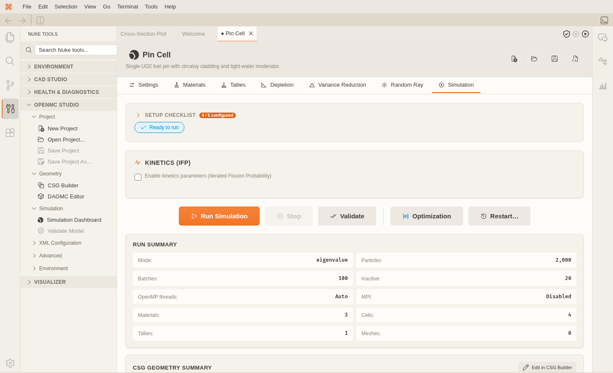

# NukeIDE

NukeIDE is an open-source Integrated Development Environment (IDE) specifically designed for nuclear simulation and engineering. Built on the extensible Theia platform, NukeIDE provides a robust and customizable environment for computational physics, reactor design, fusion energy, and radiation transport.



## Features

- **Integrated Development Environment**: A full-featured IDE powered by Theia, providing a modern code editing experience.
- **Extensible Architecture**: Custom extensions for specialized nuclear engineering tasks.
- **Nuke Core**: Python environment management, package installation, health checks, and the Nuke Tools sidebar.
- **OpenMC Studio**: No-code OpenMC modelling, tallies, depletion, variance reduction, optimization, and runs.
- **Nuke Visualizer**: Native 3D/2D viewers for statepoints, tallies, meshes, DAGMC geometry, and depletion output.
- **Nuke CAD**: Parametric CAD, sketching, assemblies, drawings, DAGMC export, meshing, and FEM.
- **Cross-Platform**: Browser and Electron desktop deployments, plus an all-in-one Docker image.

## Getting Started

To set up and run NukeIDE locally, follow these steps:

### Prerequisites

- Node.js (>=22.13.0)
- Yarn (>=1.7.0 <2)
- Python 3.13 for the tested backend profile

### Installation

1. **Clone the repository:**

   ```bash
   git clone https://github.com/nukehub-dev/nuke-ide.git
   cd nuke-ide
   ```

2. **Install dependencies and build the project:**

   ```bash
   yarn
   ```

   This installs root dependencies, hoists shared packages, and runs each extension's `prepare` build. Applications are bundled separately with `yarn build:browser` or `yarn build:electron`.

3. **Download Theia plugins:**

   ```bash
   yarn download:plugins
   ```

   This command downloads pre-configured Theia plugins required for NukeIDE.

## Running the Application

### Browser Application

To start the browser-based version of NukeIDE:

```bash
yarn start:browser
```

### Electron Application

To start the Electron-based desktop application:

```bash
yarn start:electron
```

## Building the Project

### Build All

To build all extensions:

```bash
npx lerna run build
```

### Build Specific Applications

- **Browser:**

  ```bash
  yarn build:browser
  ```

- **Electron:**

  ```bash
  yarn build:electron
  ```

### Build Individual Extensions

Navigate to the extension directory (e.g., `extensions/nuke-essentials`) and run:

```bash
yarn build
# or
tsc
```

## Project Structure

- `applications/`: Contains the different NukeIDE application builds (browser, electron, docker).
- `extensions/`: Houses all the custom Theia extensions developed for NukeIDE.
- `resources/`: Static assets like logos and HTML preload templates.
- `configs/`: Shared configuration files.

## Documentation

In the IDE, open `Help → Documentation`. The same guides are in the repository:

- [Documentation index](docs/index.md)
- [Getting started](docs/getting-started.md)
- [Installation](docs/installation.md)
- [Extension catalogue](docs/extensions.md)

## Contributing

We welcome contributions to NukeIDE! Please refer to our [GitHub Issues](https://github.com/nukehub-dev/nuke-ide/issues) for ongoing tasks and discussions. Contribution guidelines, project conventions, and verification commands live in [AGENTS.md](AGENTS.md) — run `yarn lint`, `yarn test:python`, `yarn test:ts`, and `npx lerna run build` before committing.

## License

NukeIDE is released under the [BSD-2-Clause License](https://opensource.org/licenses/BSD-2-Clause).
