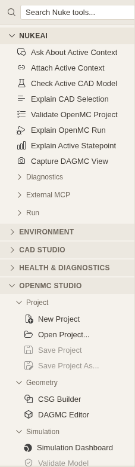

# NukeAI Actions

NukeAI is available where you work: as a dedicated chat agent, as a section in the Nuke Tools sidebar, and as
commands in the Command Palette. The actions open a focused chat and send a short, read-only request with your active
workspace context attached.

## Open the actions

Open the **Nuke Tools** view from the activity bar (the tools icon), or run **Nuke: Focus Tools Sidebar** from the
Command Palette. The **NukeAI** section is the first section in the sidebar.

| Action                    | What it asks NukeAI to do                                                           |
| ------------------------- | ----------------------------------------------------------------------------------- |
| Ask About Active Context  | Explain what the active CAD document, OpenMC project, and dataset let you do next.  |
| Attach Active Context     | Add the `#nukeContext` chip to the active chat.                                     |
| Check Active CAD Model    | Summarize the active CAD document, including counts, selection, and warnings.       |
| Explain CAD Selection     | Explain the selected solid or solids and any hidden solids.                         |
| Validate OpenMC Project   | Validate the active OpenMC project and group issues by severity.                    |
| Diagnose CSG Geometry     | Focus project diagnosis on CSG surfaces, cells, universes, lattices, and findings.  |
| Diagnose DAGMC Model      | Focus project diagnosis on the DAGMC file, volumes, materials, and graveyard state. |
| Explain OpenMC Run        | Summarize the active run status and the recent log tail.                            |
| Refresh Active Run Status | Read the active OpenMC run state, working directory, and recent log tail.           |
| Explain Active Statepoint | Explain k-effective, batches, tallies, and uncertainty in the active dataset.       |
| Review OpenMC Settings    | Summarize the project and review settings; preview a concrete change only.          |
| Capture DAGMC View        | Capture the active DAGMC viewport and describe the preview.                         |

Every action is also available in the Command Palette under the `NukeAI:` prefix. The command-palette label names the
action, and the chat transcript shows the shorter action label. **Review OpenMC Settings** is a Command Palette and
welcome quick-start action; the other rows also appear in the NukeAI sidebar section.

Before opening a chat, each action checks for the CAD document, OpenMC project, active run, or statepoint it needs. If
that context is missing, NukeAI shows a warning naming the prerequisite and does not start a model request.

## In domain menus

NukeAI actions also appear beside the work, in the menu or toolbar owned by the active domain:

| Surface                                   | NukeAI actions                                                                                                                                                   |
| ----------------------------------------- | ---------------------------------------------------------------------------------------------------------------------------------------------------------------- |
| CAD viewport toolbar and right-click menu | **Ask About Context**, **Diagnose CAD Model**, **Explain Selection**, **Check Active CAD Model**                                                                 |
| OpenMC Studio Simulation tab toolbar      | **Diagnose Project**, **Validate and Explain**, **Diagnose CSG Geometry**, and **Diagnose DAGMC Model** (validation); **Diagnose Run** and **Explain Run** (run) |
| DAGMC editor header                       | **Capture View**, **Diagnose Statepoint** (after a statepoint loads), **Ask About Context**                                                                      |
| DAGMC viewer right-click menu             | **Capture View**, **Diagnose Statepoint**, **Ask About Context**                                                                                                 |
| Statepoint viewer header and loader       | **Ask About Context**, **Explain Statepoint**, **Diagnose Statepoint**                                                                                           |
| Tally viewer right-click menu             | **Ask About Context**, **Explain Statepoint**, **Diagnose Statepoint** (only with a loaded tally)                                                                |

The statepoint header, CAD document toolbar, and DAGMC editor header open a compact **NukeAI actions**
menu. The trigger is a small Actions button on wide panels and collapses to its icon on narrow ones; the
accessible name and tooltip stay available either way. `Esc` closes the menu and returns focus to the
trigger, and the rows stay in registry order. The context menus keep their existing rows, and the OpenMC
Simulation tab keeps its inline validation and run groups.

Each entry runs the same read-only command as its sidebar and Command Palette action. The domain menus never carry
their own AI logic: they read command-backed descriptors from the neutral `nuke-core` context-action registry. When
NukeAI is not installed in the build, those commands do not exist and the NukeAI group is hidden instead of showing
disabled rows. A row is not disabled when its prerequisite is missing; the command's existing preflight explains what
to load first.

## Diagnostics

The **Diagnostics** subsection under **NukeAI** opens the read-only **Nuke Diagnostics** agent with six focused
requests: **Diagnose Active CAD Model**, **Diagnose OpenMC Project**, **Diagnose CSG Geometry**, **Diagnose DAGMC
Model**, **Diagnose OpenMC Run**, and **Diagnose Active Statepoint**. Each one reports severity-coded findings with the
tool evidence behind them and closes with safe next steps. See [Nuke Diagnostics](diagnostics.md) for the findings, severity rules, and the statepoint metadata
limitation.

## Inspect capabilities and logs

Two read-only commands help when debugging NukeAI itself:

- **NukeAI: Show Capability Catalog** lists the capabilities enabled in the current context with their id, title, risk,
  version, category, tags, and availability. Selecting a row copies the id and opens a detail view; nothing is invoked.
- **NukeAI: Show Tool Metrics** shows the last 20 local tool calls or aggregate counts by capability.

See [Local Audit Logs](audit.md) for where the metrics and applied-edit journals live, what they never record, and how to
delete them.

## Tool names

Each capability is registered in the chat under a sanitized tool name. For example, **Check Active CAD Model** calls
`nuke_cad_summarizeDocument`, and **Validate OpenMC Project** calls `nuke_openmc_validateProject`. Capability ids stay
the stable identifiers for extension authors: `nuke.cad.summarizeDocument` is exposed as
`nuke_cad_summarizeDocument`, and the remaining ids replace dots with underscores in the same way.

## Read-only by default

The sidebar actions and the six diagnostics actions only read state. They do not move geometry, edit an OpenMC
project, open viewers, start or cancel runs, or write files. **Review OpenMC Settings** may prepare a read-only preview
of a concrete change, but it never applies one. If a tool cannot see the required state, NukeAI reports what is missing
instead of inventing a path or a result.

Write and execute capabilities still exist in the agent. Exporting DAGMC, importing geometry, running OpenMC, and
opening a statepoint viewer require explicit confirmation in the conversation. The sidebar actions never confirm those
operations for you.

## Next steps in result cards

A finished NukeAI result card can suggest follow-up capabilities. Read-only suggestions show a **Run** button that
executes the step immediately and replaces the card with the new result. State-changing suggestions show **Ask NukeAI**
instead: it opens a focused chat prompt that asks NukeAI to inspect the current state, request any missing inputs, and
ask for confirmation before writing, executing, or destructive work. The card never performs those steps itself, so the
normal confirmation flow still applies.

## Safe OpenMC edits

OpenMC run settings, materials, tallies, CSG geometry, and DAGMC volume materials use a dedicated preview → apply → undo loop. Project creation and Python export are confirmed file writes and are not undoable. NukeAI previews the change as
a **Changes** diff card, applies it only after explicit confirmation with **Apply with NukeAI**, and offers **Undo**
for an applied change. See [Safe Edits](safe-edits.md) for the supported fields, the confirmation behavior, and
the in-memory undo lifetime.

## The NukeAI agent

The NukeAI agent is pinned automatically when you use an action. To start a chat yourself, open **AI Chat** and choose
**NukeAI** as the agent, or mention it in the request. The agent knows the CAD → DAGMC → OpenMC → statepoint workflow
and uses the capability tools published by the domain extensions.

The agent receives the same active-workspace summary as the context chip. The summary lists the active CAD document,
OpenMC project, dataset, and workspace roots; missing entries appear as `none`.

The diagnostics actions pin the separate **Nuke Diagnostics** agent. You can also choose it directly in AI Chat for
read-only triage of the CAD model, OpenMC project or run, and loaded statepoint.

## The context chip

**NukeAI: Attach Active Context** creates a focused chat session when none exists, then adds `#nukeContext` to it. The
chip keeps the active paths attached to your next request, so you can ask follow-up questions without restating the
document or project. Any action that sends a request includes the same context automatically.

## Preview gallery

Saved viewport captures and tool results that carry a preview or artifact live under `.nuke-ide/ai/previews`. Run **NukeAI: Open
Preview Gallery** to browse the newest bundles in a read-only widget; selecting a card opens the saved image or
artifact. Run **NukeAI: Clear Preview History** to delete the history after confirmation. The gallery itself never
deletes or regenerates anything. See [Preview Gallery](previews.md) for the bundle layout and retention.

## External MCP

The **External MCP** subsection starts and stops the opt-in MCP endpoint for external clients. See
[MCP Clients](mcp-clients.md) for the endpoint configuration and security notes.

## Requirements

- CAD actions need an open `.nuke-cad` document or an equivalent active CAD model.
- OpenMC actions need an active OpenMC Studio project; run-status questions also need a run directory.
- Statepoint and capture actions need a loaded dataset or an open DAGMC viewer.
- NukeAI needs a configured chat language model. Without one, the chat opens but the request reports that no model is
  available.

For the tool contract, see [Architecture](../dev/architecture.md) and [Adding a Capability](../dev/adding-a-capability.md).
