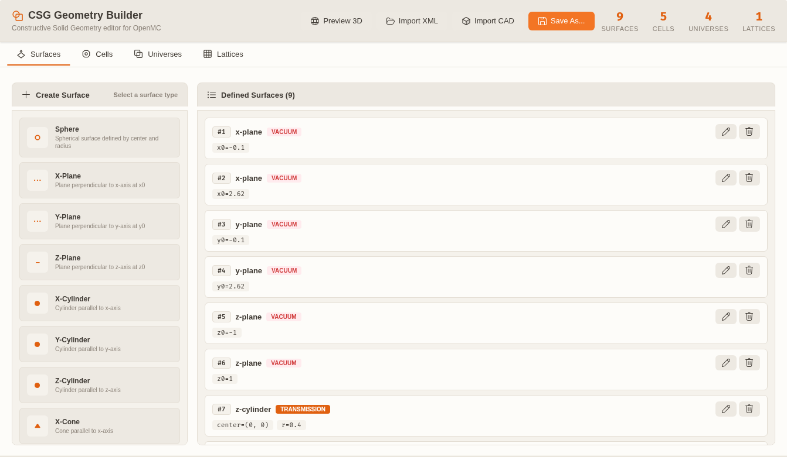

# Geometry Workflows

OpenMC Studio supports two geometry workflows: **CSG Builder** for constructive solid geometry defined by surfaces and regions, and **DAGMC Editor** for CAD-based `.h5m` geometries. Both integrate with the 3D preview provided by nuke-visualizer.

XML import reconstructs CSG surfaces, cells, universes, rectangular/hexagonal lattices, cell transforms, periodic pairs, and albedo. DAGMC import keeps the `<dagmc_universe>` filename and asks you to open the mesh in the DAGMC Editor for volume metadata. Import results appear in the dashboard's XML import report.

---

## CSG Builder

The CSG Builder lets you create OpenMC geometry from primitive surfaces, combine them into cells with Boolean region expressions, and arrange cells into universes and lattices.



_The Surfaces tab pairs a primitive palette with the defined-surface list; descriptive names keep the list and validation messages readable, while cell region expressions still refer to surface IDs._

### Opening the CSG Builder

### Method 1: Dashboard

In the Simulation Dashboard, go to the **Simulation** tab and click **"Edit in CSG Builder"** in the geometry summary (or use the menu below).

### Method 2: Command Palette

`Ctrl+Shift+P` → **`OpenMC/View: Open CSG Builder`**

### Method 3: Menu

`Tools → OpenMC Studio → Geometry → CSG Builder`

---

### Adding Surfaces

Surfaces are the primitive building blocks of CSG geometry.

1. In the CSG Builder sidebar, click **"Add Surface"**.
2. Choose a surface type:

| Surface Type        | Equation / Description             | Coefficients Required                    |
| ------------------- | ---------------------------------- | ---------------------------------------- |
| **Plane**           | `ax + by + cz = d`                 | `a, b, c, d`                             |
| **Sphere**          | `(x−x₀)² + (y−y₀)² + (z−z₀)² = r²` | `x₀, y₀, z₀, r`                          |
| **X-Cylinder**      | `(y−y₀)² + (z−z₀)² = r²`           | `y₀, z₀, r`                              |
| **Y-Cylinder**      | `(x−x₀)² + (z−z₀)² = r²`           | `x₀, z₀, r`                              |
| **Z-Cylinder**      | `(x−x₀)² + (y−y₀)² = r²`           | `x₀, y₀, r`                              |
| **X-Cone**          | `(y−y₀)² + (z−z₀)² = r²(x−x₀)²`    | `x₀, y₀, z₀, r²`                         |
| **Y-Cone**          | `(x−x₀)² + (z−z₀)² = r²(y−y₀)²`    | `x₀, y₀, z₀, r²`                         |
| **Z-Cone**          | `(x−x₀)² + (y−y₀)² = r²(z−z₀)²`    | `x₀, y₀, z₀, r²`                         |
| **Torus**           | Rotationally symmetric ring        | Axis, center, major radius, minor radius |
| **General Quadric** | `Ax² + By² + Cz² + ... = 0`        | 10 coefficients                          |

3. Enter coefficients in the form. The surface appears in the **Surfaces List** with an auto-assigned ID.
4. Set the **Boundary Condition** (optional): `vacuum`, `reflective`, `periodic`, or `white`. Reflective, periodic, and white boundaries accept an **albedo** (importance multiplier, default `1`; values outside 0–1 are flagged, and above 1 is discouraged). Periodic boundaries show a **Periodic Partner** picker that lists only the other periodic planes; the editor prevents self-pairing and, on save, sets the reciprocal link on both surfaces. Both surfaces show a `paired with #N` badge, or `unpaired` until a partner is chosen.

> **Tip:** Name surfaces descriptively (e.g., "Fuel Outer Radius") — the names appear in region expressions and make debugging easier.

---

### Defining Cells

Cells are volumes bounded by surfaces and filled with materials, universes, or left void. The cell form is split into **Identity**, **Region**, **Placement**, and a collapsed **Advanced** section.

1. Click **"Add Cell"** in the toolbar.
2. Fill in the cell form:

| Field                 | Description                                                                                        |
| --------------------- | -------------------------------------------------------------------------------------------------- |
| **Name**              | Descriptive label                                                                                  |
| **Fill target**       | Searchable, type-grouped picker for materials, universes, and lattices; Void leaves the cell empty |
| **Region**            | Boolean expression of surface IDs plus the visual builder                                          |
| **Rotation φ/θ/ψ**    | Optional intrinsic Tait-Bryan angles in degrees (universe/lattice fills)                           |
| **Translation x/y/z** | Optional translation in cm, applied after rotation                                                 |
| **Density Override**  | Optional density greater than zero for material fills; blank uses the material density             |
| **Temperature**       | Optional advanced temperature in Kelvin                                                            |

3. The fill picker shows `#id name` with a Material/Universe/Lattice type badge and filters as you type. Universe 0 (the root) is never offered because OpenMC cannot fill a cell with it.
4. **Clear transform** resets rotation and translation only; the region and fill stay unchanged.
5. Inline errors appear under the affected field for a missing fill, a partial/non-numeric rotation or translation, a non-positive density, or a transform on a material/void cell.

6. **Region Expressions:** Use parentheses, spaces, and the operators:

| Operator    | Meaning                      | Example                          |
| ----------- | ---------------------------- | -------------------------------- |
| `−` (minus) | Negative half-space (inside) | `−1` = inside sphere 1           |
| ` ` (space) | Intersection (AND)           | `−1 2` = inside 1 AND outside 2  |
| `:`         | Union (OR)                   | `−1 : −2` = inside 1 OR inside 2 |
| `~`         | Complement (NOT)             | `~1` = outside sphere 1          |

Example — fuel pin clad by zircaloy in water:

```
Fuel:     −1
Clad:      1 −2
Coolant:   2 −3
Outside:   3
```

7. Click **"Validate Region"** to check for syntax errors and unbounded regions before adding the cell.

---

### Universes

Universes group cells together so they can be reused as fills.

1. Click **"Add Universe"**.
2. Drag cells from the **Cells List** into the universe.
3. Universe **0** is always the root universe (the top-level geometry). OpenMC's XML format has no explicit root element, so the root cannot be reassigned; keep top-level cells in universe 0.

| Property  | Description                                           |
| --------- | ----------------------------------------------------- |
| **ID**    | Unique integer (0 is the root)                        |
| **Name**  | Descriptive label                                     |
| **Cells** | List of member cells (a cell belongs to one universe) |

---

### Lattices

Lattices are regular arrays of universes — essential for reactor assemblies. They live in the **Lattices** tab (separate from universes so the grid/ring editors get the full panel width).

1. Open the **Lattices** tab and click **"Create rectangular lattice"** or **"Create hex lattice"**. The inline editor opens with a sensible default map.
2. Configure the definition:

| Parameter          | Description                                                        |
| ------------------ | ------------------------------------------------------------------ |
| **ID / Name**      | Unique integer and descriptive label                               |
| **Cells X / Y**    | Number of rectangular lattice cells per axis                       |
| **Z Layers**       | `1` keeps the lattice 2D; larger values add axial layers           |
| **Pitch**          | Center-to-center distance in cm (one per dimension)                |
| **Lower Left**     | `[x, y]` or `[x, y, z]` corner of a rectangular lattice            |
| **Rings**          | Hexagonal ring count including the center ring                     |
| **Orientation**    | Hexagon orientation: `y` (flat top, the default) or `x`            |
| **Axial Levels**   | `1` keeps the hex lattice 2D; larger values add `<n_axial>` levels |
| **Center**         | `[x, y]` or `[x, y, z]` center of a hexagonal lattice              |
| **Outer Universe** | Universe ID for positions outside the defined map                  |

3. Assign universes with the **Universe assignment** editor:
   - Pick the **Brush universe** from the nested universes (universe 0 is the root and is never offered).
   - **Paint** assigns one position, **Fill row** (rect) or **Fill ring** (hex) fills the clicked row/ring, and **Clear** unsets a position.
   - Click a row or ring header to fill it immediately; **Fill all** fills every position with the brush universe, and **Clear all** unsets every position.
   - Rectangles show row/column headers (row 0 is the top row, x fastest). Hexagons show the ring index and position with a legend: ring 0 is outermost, position 0 starts at the top and runs clockwise.
4. Click **Save Lattice**. The card shows a compact summary such as `2×2×1 · pitch 1.26 × 1.26 · 4 positions, 2 universes`. Every referenced universe must exist and contain at least one cell; the editor warns about referenced universes with no cells, and validation blocks the run.
5. Click **Preview 3D** in the Lattices tab or on a card to regenerate XML and open the native geometry viewer. For a saved project the XML is written beside the project file; an unsaved project asks for an output folder first.

> **Tip:** Use the **Outer Universe** to define reflector or coolant regions surrounding the lattice without explicitly tiling them. Lattice and universe IDs share OpenMC's fill namespace, so they must not collide. Every universe referenced by a lattice position or the outer fill needs at least one cell — OpenMC omits empty universes from geometry.xml, so an empty universe cannot be used as a fill.

Lattice units are centimeters. For a rectangular lattice, `x` varies fastest within a row and row 0 is the top row, matching `openmc.RectLattice.universes`; hexagonal ring 0 is outermost and theta starts at the top and proceeds clockwise.

---

### 3D Preview

Click **"Preview 3D"** at any time to visualize the current geometry.

- A native **geometry viewer** tab opens (via nuke-visualizer) and reloads on every preview.
- Cells are colored by material or by cell ID.
- Mouse controls: rotate (left-drag), pan (right-drag), zoom (scroll).
- The preview updates automatically when you regenerate XML.

---

## Validation Banner

The top of the CSG Builder shows a geometry validation banner whenever the model has issues. It uses the same `validateGeometryModel` rules as the Simulation tab's run-readiness checklist, so the two cannot disagree.

- Errors say how many issues block the model; warnings are listed separately and do not claim to block a run.
- Issues are grouped by tab (Surfaces, Cells, Universes, Lattices) with a count per group.
- Click an issue to switch to its tab, open the affected cell/surface/lattice editor, and focus the owning card.
- An unpaired periodic surface, a partner that is not periodic, duplicate pairings, a missing fill, a non-positive density, an invalid rotation/translation, an empty referenced universe, and a root/lattice ID collision all appear here before a run.

---

## DAGMC Editor

The DAGMC Editor is for working with CAD-based `.h5m` files. You can view volumes, assign materials, and manage groups without leaving NukeIDE.

### Opening the DAGMC Editor

### Method 1: Menu

`Tools → OpenMC Studio → Geometry → DAGMC Editor`, then click **Open File** in the editor header.

### Method 2: Command Palette

`Ctrl+Shift+P` → **`OpenMC/View: Open DAGMC Editor`**

### Method 3: CSG Builder

When the current project uses DAGMC geometry, click **DAGMC Editor** in the CSG Builder header.

> **Note:** Clicking a `.h5m` file in the Explorer does not open the DAGMC Editor. The OpenMC open handler claims `.nuke-openmc` project files; use the menu or command above for DAGMC geometry.

---

### Viewing Volumes

The DAGMC Editor displays all volumes in a scrollable grid. Click any volume card to open a **centered detail modal** that shows:

| Property           | Description                                                      |
| ------------------ | ---------------------------------------------------------------- |
| **Volume ID**      | DAGMC volume identifier                                          |
| **Name**           | Volume name (if tagged)                                          |
| **Material**       | Assigned material tag                                            |
| **Group Tags**     | DAGMC group memberships                                          |
| **Bounding Box**   | Axis-aligned bounds `[xmin, ymin, zmin]` to `[xmax, ymax, zmax]` |
| **Surface Count**  | Number of bounding surfaces                                      |
| **Triangle Count** | Faceted mesh triangle count                                      |

The modal floats above the volume grid, so you can scroll through the list without losing your place. Click outside the modal or press `Escape` to close it.

Click **"View 3D"** in the modal to visualize the selected volume in the 3D viewer. Use Ctrl/Cmd-click on the grid to select multiple volumes for combined visualization.

---

### Assigning Materials

1. Click a volume card to open the detail modal.
2. In the **Material** section, select a material from the dropdown (populated from the current project's Materials tab) or type a new material name.
3. The material tag is written to the `.h5m` file immediately.

> **Tip:** DAGMC materials are stored as string tags on volumes. They must match material names in your `materials.xml` at runtime.

---

### Managing Groups

DAGMC uses groups to organize volumes and surfaces (e.g., "graveyard", "reflective_boundary").

| Action                  | How To                                                             |
| ----------------------- | ------------------------------------------------------------------ |
| **Create Group**        | Switch to the **Groups** tab → Click **"New Group"**, enter a name |
| **Add Volume to Group** | Open volume modal → **"Add to Group"** → choose group              |
| **Remove from Group**   | Open volume modal → **"Remove from Group"**                        |
| **Delete Group**        | Groups tab → Click group → **"Delete Group"**                      |
| **Rename Group**        | Groups tab → Click group → **"Rename"**                            |

Important groups:

| Group Name   | Purpose                                                            |
| ------------ | ------------------------------------------------------------------ |
| `graveyard`  | The bounding void region; particles leaving this volume are killed |
| `reflective` | Surfaces with reflective boundary condition                        |
| `vacuum`     | Surfaces with vacuum boundary condition                            |
| `periodic`   | Surfaces with periodic boundary condition                          |

---

### Refacet Geometry

The **Faceting** tab lets you regenerate the DAGMC mesh from the original source CAD with a different tolerance. This is useful when the existing mesh is too dense (slow simulation, large file) or too coarse (inaccurate surface representation).

#### Workflow

1. **Open the Faceting tab** in the DAGMC Editor.
2. **Select a source CAD file** — Click **Browse** to pick the original STEP/IGES file, or **Auto-detect** to search the same directory as the `.h5m` file.
3. **Choose a tolerance** — Use preset buttons (**Draft 1 cm**, **Standard 0.5 cm**, **Fine 0.1 cm**, **Ultra 0.01 cm**) or drag the slider for fine-tuning.
4. **Review the impact preview** — The gauge shows the estimated triangle count and the change relative to the current mesh.
5. **(Optional) Enable Imprint & Merge** — Check **"Imprint & merge shared surfaces"** to produce a conformal mesh between adjacent volumes (slower, but better for particle transport).
6. **Click Generate** — The new `.h5m` is saved next to the original with a `_refaceted` suffix. You can load it immediately or keep the current file. If the old file had a `mat:graveyard` volume, it is re-created on the re-tessellated output automatically (the source CAD does not contain the graveyard shell); a warning confirms this.

> **Tip:** Smaller tolerance = more triangles = finer mesh. For large assemblies (tokamaks, reactor vessels), **Draft** or **Standard** presets usually give a good balance between accuracy and file size.

---

### Saving the DAGMC File

When a DAGMC file is loaded, the header shows a **Save As** button. Click it to save a copy of the current `.h5m` file under a new name or location. This is useful for:

- Creating checkpoints before bulk material assignments
- Exporting a modified model for use in other workflows
- Renaming files to match project conventions

The Save As button only appears when a file is actually loaded.

---

### 3D Preview via Nuke-Visualizer

Click **"3D View"** in the header to open the full model in the 3D viewer:

- Volumes are rendered as watertight triangular meshes.
- Colors are assigned by material tag or volume ID.
- Use the [Base Visualizer controls](../../../nuke-visualizer/docs/user/base-visualizer.md) for opacity, clipping, and screenshots.

For large models, use **"Preview Selected"** in the volume modal to load only the selected volumes and reduce memory usage.

---

## CAD Import

Import STEP, IGES, BREP, and STL files and convert them to CSG surfaces or DAGMC `.h5m`.

### Import Workflow

1. Use the CAD Import feature from the Simulation Dashboard.
2. Select one or more files (`.step`, `.stp`, `.iges`, `.igs`, `.brep`, `.stl`).
3. Choose the target format:

| Target                | Description                                                                                  |
| --------------------- | -------------------------------------------------------------------------------------------- |
| **CSG (Approximate)** | Fits analytic surfaces (planes, cylinders, spheres) to CAD geometry. Best for simple shapes. |
| **DAGMC (.h5m)**      | Converts directly to a watertight mesh for DAGMC transport. Best for complex CAD.            |

4. For CSG conversion, review the generated surfaces and adjust tolerances.
5. For DAGMC conversion, set the mesh tolerance and output path.

> **Tip:** CSG conversion works best on primitives (cylinders, boxes, spheres). Highly curved or organic shapes should use DAGMC.

---

## Robustness Notes

### Handling Corrupt or Partial Volumes

Some DAGMC files contain volumes that cannot be fully interrogated (e.g., missing triangle data or invalid topology). The DAGMC Editor **gracefully skips these individual volumes** rather than crashing the entire load. A warning toast appears listing how many volumes were skipped, and the remaining valid volumes are still displayed and editable.

If you see "skipped N volumes" warnings:

- The file may have been generated with an older or incomplete mesher.
- Try re-faceting the source CAD with the current importer (see [CAD Import](cad-import.md)).
- Check the Python output channel for the specific volume IDs that failed.

---

## Tips

- **Validate before running:** After building CSG geometry, run `Tools → OpenMC Studio → Simulation → Validate Model` to check for errors before simulation.
- **DAGMC graveyard:** Always ensure your DAGMC model has a `graveyard` group. Without it, OpenMC cannot terminate escaping particles. The DAGMC Editor detects a missing graveyard and can create one automatically (see [DAGMC Editor](dagmc-editor.md)).
- **Unit consistency:** OpenMC uses centimeters. Ensure your CAD files are in cm or convert during import.
- **Complex lattices:** Fill the universe grid once and reuse the same universe ID across positions; the outer universe covers everything beyond the array.
