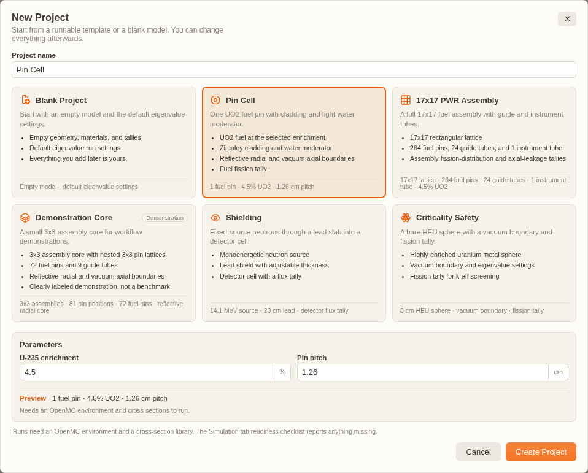

# Project Management

OpenMC Studio uses `.nuke-openmc` JSON project files to bundle your simulation state — geometry, materials, settings, tallies, and analysis definitions — with references to external assets. Result files are referenced on disk rather than embedded.

---

## Creating a New Project

### Method 1: New Project Template

1. Run `OpenMC/Project: New Project` from the Command Palette (or use `Tools → OpenMC Studio → Project → New Project`, or click **New Project** in the dashboard header).
2. Pick a template card (see below) and optionally adjust its parameters.
3. Enter a project name and click **Create Project**.
4. The dashboard opens on the **Simulation** tab. Use `Tools → OpenMC Studio → Project → Save Project As...` (or `OpenMC/Project: Save Project As...`) to choose a `.nuke-openmc` location.

### Method 2: Import Existing XML

1. Run `OpenMC/Project: New Project`, create a blank project, then use `Tools → OpenMC Studio → XML Configuration → Import from XML...` (or the CSG Builder's **Import XML** button).
2. Select the directory containing `geometry.xml`, `materials.xml`, `settings.xml`, `tallies.xml`, and (optionally) `plots.xml`.
3. The imported state replaces the current model state. Review the dashboard import report (menu import) or the status message (CSG Builder import) for ignored constructs and items that need attention.

---

## Saving the Current State

A `.nuke-openmc` file is a JSON project document. It contains the complete model state and references to external files:

| Content                          | Description                                                   |
| -------------------------------- | ------------------------------------------------------------- |
| `version` / `state.metadata`     | Schema version, name, description, timestamps                 |
| `state.geometry`                 | Surfaces, cells, universes, lattices, transforms              |
| `state.materials`                | Compositions, densities, thermal scattering, volumes          |
| `state.settings`                 | Run mode, sources, variance reduction, runtime settings       |
| `state.tallies` / `state.meshes` | Tally definitions and mesh references                         |
| `state.derivedTallies`           | Analysis-only expression definitions (never simulation input) |
| `state.plots`, `state.depletion` | Plot and depletion configuration                              |
| `state.shutdownDose`             | R2S/D1S driver configuration                                  |
| `fileSync`                       | Optional links to generated XML files                         |

### Save vs. Save As

| Action              | Behavior                                                         |
| ------------------- | ---------------------------------------------------------------- |
| **Save Project**    | Overwrites the existing `.nuke-openmc` file with current state   |
| **Save Project As** | Creates a new `.nuke-openmc` file; leaves the original untouched |

> **Tip:** Save the project before a long run; statepoints remain on disk and can be opened from the analysis viewers.

### Portable Asset Paths

External asset references are stored **relative to the `.nuke-openmc` project file** and resolved against the project directory on load, XML generation, and run time. This covers the DAGMC file paths (`dagmcFile`, `dagmcInfo.filePath`) and the MGXS library path (`mgxsLibrary`). Because no absolute paths are baked in, projects stay portable across machines — moving or sharing a project folder keeps the references valid as long as the assets travel with it.

---

## Opening an Existing Project

### Method 1: Dashboard or Command Palette

Click **Open Project** in the dashboard header, use `Tools → OpenMC Studio → Project → Open Project...`, or run `OpenMC/Project: Open Project...`, then select a `.nuke-openmc` file.

### Method 2: Explorer

Click a `.nuke-openmc` file in the Explorer sidebar. OpenMC Studio's open handler loads the project and reveals the dashboard.

### What Happens on Open

1. The JSON state is loaded and migrated to the current schema version.
2. The dashboard, CSG Builder, Tally Configurator, and analysis widgets read the same state.
3. External asset references (DAGMC mesh, MGXS library, unstructured meshes) resolve relative to the project directory.
4. Result files such as statepoints remain on disk and are opened from the analysis viewers.

---

## Project Templates

Templates give you a verified starting point instead of a blank slate. They are ordinary project states, not a second schema.



_Pick a template card to see what the starting model includes and which parameters it exposes; Create Project opens the new dashboard on the Simulation tab so you can review the model before the first run._

| Template               | What you get                                                                                                                    |
| ---------------------- | ------------------------------------------------------------------------------------------------------------------------------- |
| **Blank Project**      | Empty geometry/materials/tallies with default eigenvalue settings                                                               |
| **Pin Cell**           | One UO2 fuel pin, Zircaloy cladding, light-water moderator, reflective radial and vacuum axial boundaries, fuel fission tally   |
| **17x17 PWR Assembly** | 17×17 rectangular lattice with 264 fuel pins, 24 guide tubes, and 1 instrument tube; assembly fission and axial-leakage tallies |
| **Demonstration Core** | 3×3 assembly core with nested 3×3 pin lattices (72 fuel pins, 9 guide tubes); clearly labeled demonstration, not a benchmark    |
| **Shielding**          | Fixed-source monoenergetic neutrons through a lead slab into a detector cell with a flux tally                                  |
| **Criticality Safety** | Bare HEU metal sphere with a vacuum boundary, eigenvalue settings, and a fission tally                                          |

The picker shows each card's icon, description, "what's included" list, and a live preview. Enrichment, pitch, source energy, shield thickness, and sphere radius are exposed only where they change the model. **Blank Project** is the default.

To create a custom starting point, build a project and save it as a normal `.nuke-openmc` file; there is no marketplace or template-authoring format.

---

## Project Metadata

Click the project name in the dashboard header to edit the display **Name** and optional **Description**. The name also appears in the editor title, with a `●` while there are unsaved changes.

The `.nuke-openmc` file stores the schema version, author when present, and created/modified timestamps. There is no separate Project Info panel, no editable author field, and no user-facing UUID or OpenMC-version metadata.

> **Tip:** Use the Description field to record modeling assumptions, reference data sources, or validation benchmarks the project targets.

---

## Exporting to Python Script

The **Python Exporter** generates a standalone `model.py` script that reproduces your project using the OpenMC Python API.

### How to Export

1. Open the project you want to export.
2. Run `OpenMC/View: Generate Python Script` or use `Tools → OpenMC Studio → Advanced → Generate Python Script`.
3. Choose a destination path.
4. Click **Save**.

There is no include/exclude dialog: the exporter writes the current model as a single file, using the active OpenMC compatibility profile. Derived tallies are analysis-only and are not included.

### What You Get

A single `.py` file containing:

```python
import openmc

# Materials
fuel = openmc.Material(name="UO2")
# ...

# Geometry
# ...

# Settings
settings = openmc.Settings()
# ...

# Tallies
# ...

# Export to XML
model.export_to_xml()
```

> **Tip:** The exported script is ideal for version control, batch submissions on HPC clusters, or sharing with users who do not use OpenMC Studio.

---

## Importing from Nuke CAD

Models authored in the **Nuke CAD** extension can be brought into OpenMC Studio in one step.

1. Use `Tools → OpenMC Studio → Project → Import from nuke-cad...` (or `OpenMC/Project: Import from nuke-cad...`).
2. Select the `.h5m` file produced by Nuke CAD.
3. OpenMC Studio reads the sibling `.regions.json` manifest (if present), sets the DAGMC geometry reference, and creates placeholder materials for every manifest material name that does not already exist.
4. Fill in the placeholder compositions in the Materials tab and run as usual.

The manifest material names are matched against existing OpenMC materials by name, so keeping names consistent between Nuke CAD and OpenMC Studio lets the import work automatically.

## XML Import / Export Workflow

You can exchange models with standard OpenMC command-line workflows using XML import and export.

### Exporting to XML

1. Click **Generate XML Files** in the dashboard header, or use `Tools → OpenMC Studio → XML Configuration → Generate XML Files`.
2. Choose a destination folder.
3. The following files are written:
   - `geometry.xml` (for CSG or DAGMC geometry)
   - `materials.xml`
   - `settings.xml`
   - `tallies.xml` (if tallies exist)

The dashboard export does **not** write `plots.xml`; [Native Plotting](native-plotting.md) generates that file for plot runs.

### Importing from XML

1. Use `Tools → OpenMC Studio → XML Configuration → Import from XML...` (or the CSG Builder's **Import XML** button).
2. Select the folder containing `geometry.xml` (and optionally `materials.xml`, `settings.xml`, `tallies.xml`, `plots.xml`).
3. The imported state replaces the current model state. Save the current project first if you need to keep it.

### Round-Trip Safety

| Feature               | Preserved? | Notes                                                                                          |
| --------------------- | ---------- | ---------------------------------------------------------------------------------------------- |
| CSG geometry          | Yes        | Surfaces, cells, universes, lattices, transforms, periodic pairs, albedo                       |
| Materials             | Yes        | Densities, nuclides/elements, S(α,β), isotropic, depletable/volume, temperature, macroscopic   |
| Settings              | Yes        | Run mode, sources and distributions, runtime/convergence/physics/limit fields                  |
| Tallies               | Yes        | Filters (including structured pairs), scores, triggers, derivatives, higher moments            |
| Meshes                | Yes        | Regular/rectilinear/cylindrical/spherical/unstructured, mesh-filter transforms                 |
| Variance reduction    | Yes        | UFS, weight-window sets/file/checkpoints/generator                                             |
| Depletion             | Yes        | Project block, including driver-only substeps/reactivity/feeds/continuation                    |
| Plots                 | Yes        | `plots.xml` import restores slice/voxel/ray-trace, background, masks, overlap highlighting     |
| Derived tallies       | No         | Analysis-only; they live in `.nuke-openmc` and never enter simulation XML                      |
| DAGMC geometry        | Partial    | The `<dagmc_universe>` filename is preserved; the `.h5m` is not read or embedded by XML import |
| Results / statepoints | No         | XML workflow does not include `.h5` results                                                    |

Every import produces a report above the dashboard tabs with imported counts, ignored constructs, and items that need attention. See [Coverage and Limitations](coverage.md) for the full boundary.
